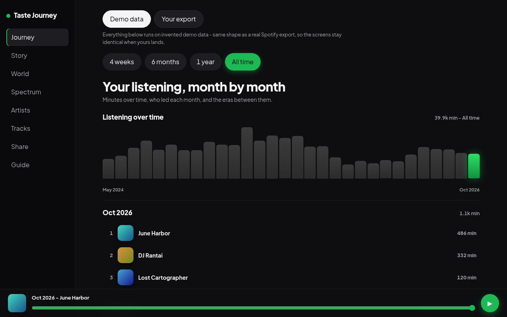

# Spotify Taste Journey

[](https://github.com/fadhilmch/spotify-taste-journey/actions/workflows/app.yml)

Explore your Spotify listening history as an interactive journey - minutes per month,
artist eras, genre spectrum, listening-story chapters and a map of where your artists
come from. Private by design: everything runs in your browser, and your data never
leaves your device.

The repo also keeps the original 2019 analysis notebooks that started the project.



## Quick start

You need Node.js 22 (20.19 or newer works) and npm:

```sh
cd app && npm install && npm run dev
```

Open the printed local URL. The app starts with clearly labeled demo data, so every
screen works without a Spotify account. To explore your own history, download your
Spotify account data export and import the `Streaming_History_Audio*.json` files -
they are read **locally in your browser** and never uploaded anywhere.

## What's here

- **`app/`** - the Taste Journey web app: Vite + React + TypeScript, Tailwind CSS v4,
  Vitest, no backend. Full feature guide, privacy notes, import instructions, stack
  rationale and styling conventions: [app/README.md](app/README.md).
- **`music_taste_analysis.ipynb` / `spotipy_spotify_api.ipynb`** - the original 2019
  analysis and data-collection pipeline, kept as written. They use
  [spotipy](https://spotipy.readthedocs.io/) with `playlist_fadel.xlsx` (a 2019 playlist
  snapshot, archived intentionally). To run them: install
  [requirements-notebooks.txt](requirements-notebooks.txt) into a virtualenv and provide
  your own `credential.json` with a Spotify app's `client_id` and `client_secret`
  (never commit it - it is gitignored).

Notebook caveat: since 27 November 2024, Spotify
[restricts several endpoints](https://developer.spotify.com/blog/2024-11-27-changes-to-the-web-api),
including Audio Features, for new apps and apps still in development mode. The pipeline's
audio-features step needs an app outside those restrictions; its metadata steps (search,
artist, album and track lookups) are unaffected.

## Contributing

See [CONTRIBUTING.md](CONTRIBUTING.md): setup, the checks CI runs (lint, format, tests,
build), and the ground rules - privacy first, honest UI, notebooks stay as written.
